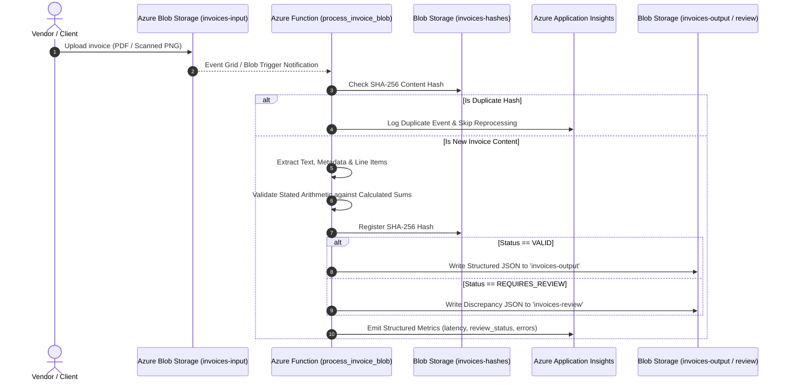

# Azure Deployment & Cloud Architecture Plan
## PS03: Azure Invoice Processing Pipeline

---

## 1. Executive Summary & Objective

This document outlines the enterprise cloud architecture, infrastructure specification, security controls, monitoring strategy, and cost-control guidelines for deploying the **Invoice Processing Pipeline** onto Microsoft Azure.

The pipeline automates the ingestion of vendor invoices, optical character recognition (OCR) and layout extraction, mathematical cross-validation of line items and tax amounts, idempotency/deduplication checks, and automated separation of valid invoices from exceptions requiring human review.

---

## 2. Cloud Architecture

### 2.1 Architecture Diagram

```mermaid
flowchart TD
    subgraph Ingestion ["1. Document Ingestion"]
        A[Vendor / ERP / Scanner] -->|HTTPS Upload| B[Azure Blob Storage: invoices-input]
    end

    subgraph Processing ["2. Serverless Processing Tier"]
        B -->|Blob Event Trigger| C[Azure Function: process_invoice_blob]
        C <-->|Hash Check / Register| D[Azure Blob Storage: invoices-hashes]
        C <-->|Cognitive OCR API / Fallback| E[Azure Document Intelligence]
        C -->|Audit Telemetry & Metrics| F[Azure Application Insights]
    end

    subgraph Security ["3. Identity & Secrets"]
        G[Azure Active Directory / Entra ID] -->|Managed Identity| C
        H[Azure Key Vault] -->|KeyVault Secret Ref| C
    end

    subgraph Routing ["4. Review & Persistence Tier"]
        C -->|Status: VALID| I[Azure Blob Storage: invoices-output]
        C -->|Status: REQUIRES_REVIEW| J[Azure Blob Storage: invoices-review]
        C -->|Status: FAILED / Corrupt| K[Azure Blob Storage: invoices-failed (DLQ)]
    end

    subgraph Downstream ["5. Downstream Consumption"]
        I -->|Event Grid Trigger| L[Automated ERP / Ledger Posting]
        J -->|Alert Notification| M[Human Accounts Payable Review Dashboard]
        K -->|SRE Alert| N[Operations Poison Queue Triage]
    end
```

### 2.2 Processing Sequence Diagram



---

## 3. Azure Compute & Storage Choices

| Component | Selected Azure Service | Tier / SKU | Justification |
| :--- | :--- | :--- | :--- |
| **Serverless Compute** | Azure Functions (Linux) | **Flex Consumption / Consumption Plan** | Automatically scales to zero during idle periods; scales out per incoming blob burst; zero server management overhead; pay strictly per-millisecond execution. |
| **Blob Storage** | Azure Blob Storage (General Purpose v2) | **Standard Storage (Hot Tier)** | Primary ingestion and structured output store. Supports high throughput, event-driven blob triggers, and granular SAS / RBAC policies. |
| **Idempotency Store** | Azure Blob Storage (`invoices-hashes`) | **Standard Hot Tier** | Stores SHA-256 hash markers with blob metadata, enabling sub-millisecond duplicate detection without spinning up an extra database. |
| **Enterprise Document OCR** | Azure Document Intelligence | **Standard S0** (Optional plug-in) | Specialized machine learning models trained on millions of global invoices, extraction of complex tables, multi-currency headers, and bounding polygons. |
| **Dead-Letter Storage** | Azure Storage Queue / Container (`invoices-failed`) | **Standard Storage** | Retains malformed or corrupt binary payloads with full exception stack traces for developer triage. |

### Storage Container Partitioning

1. `invoices-input`: Ingestion bucket where raw PDF, PNG, JPG files are dropped.
2. `invoices-output`: Verified records (`review_status == VALID`) formatted as canonical JSON ready for automated ERP integration.
3. `invoices-review`: Invoices with arithmetic discrepancies, missing mandatory fields, or confidence < 0.70 (`review_status == REQUIRES_REVIEW`).
4. `invoices-failed`: Unreadable documents, corrupted streams, or fatal parser errors (`review_status == FAILED`).
5. `invoices-hashes`: SHA-256 fingerprint records ensuring idempotency across restarts.

---

## 4. Identity and Secret Handling

### 4.1 Zero-Secret Architectural Standard
- **No hardcoded credentials**: No connection strings, API keys, or database credentials exist in source code or git commits.
- **System-Assigned Managed Identity**: Enabled on the Azure Function App to authenticate against Azure Storage, Key Vault, and Application Insights without static keys.

### 4.2 Role-Based Access Control (RBAC) Assignments

```
Azure Function (System-Assigned Identity)
  ├── Storage Blob Data Contributor  --> /subscriptions/.../resourceGroups/rg-invoices/providers/Microsoft.Storage/storageAccounts/stcerevyn
  ├── Key Vault Secrets User         --> /subscriptions/.../resourceGroups/rg-invoices/providers/Microsoft.KeyVault/vaults/kv-cerevyn
  └── Monitoring Metrics Publisher   --> /subscriptions/.../resourceGroups/rg-invoices/providers/Microsoft.OperationalInsights/workspaces/log-cerevyn
```

### 4.3 Azure Key Vault Secret Referencing
For third-party endpoints or optional enterprise OCR keys, Azure Functions App Settings utilize direct Key Vault reference syntax:

```json
{
  "DOCUMENT_INTELLIGENCE_KEY": "@Microsoft.KeyVault(VaultName=kv-cerevyn;SecretName=DocIntelligenceKey)"
}
```

---

## 5. Monitoring, Observability & Dead-Letter Handling

### 5.1 Telemetry via Azure Application Insights
All pipeline events emit structured JSON logs and custom metrics:
- `ProcessingLatencyMs`: Distribution of extraction and validation runtime.
- `ReviewStatus`: Dimensions `[VALID, REQUIRES_REVIEW, DUPLICATE_SKIPPED, FAILED]`.
- `DiscrepancyType`: Dimensions `[SubtotalMismatch, GrandTotalMismatch, MissingMandatoryField, LowConfidence]`.
- `SupplierName`: Track accuracy trends per vendor.

### 5.2 Metric Alerts
1. **High Review Rate Alert**: Fired if `REQUIRES_REVIEW` exceeds **15%** of ingested invoices over a 15-minute rolling window.
2. **Execution Failure Alert**: Fired if Azure Function errors exceed **1%** over a 5-minute window.
3. **Poison Blob / Dead-Letter Notification**: Fired immediately whenever a record is written to `invoices-failed`.

---

## 6. Step-by-Step Deployment Guide

### Prerequisites
- Azure CLI (`az`) installed and authenticated (`az login`)
- An active Azure Subscription

### 6.0 Declarative Infrastructure-as-Code Deployment (Azure Bicep)
The repository includes a production-ready Bicep template in [`infra/main.bicep`](../infra/main.bicep) that provisions the entire architecture with one command:

```bash
# 1. Create Resource Group
az group create --name rg-cerevyn-invoices-prod --location eastus

# 2. Deploy complete cloud infrastructure via Bicep
az deployment group create \
  --resource-group rg-cerevyn-invoices-prod \
  --template-file infra/main.bicep \
  --parameters environment=prod
```

### 6.1 Manual Step-by-Step Deployment (CLI Alternative)
If deploying resource-by-resource manually via Azure CLI:

### 6.2 Step 2: Provision Azure Storage Account
```bash
az storage account create \
  --name stcerevyninvoicesprod \
  --resource-group rg-cerevyn-invoices-prod \
  --location eastus \
  --sku Standard_LRS \
  --kind StorageV2 \
  --access-tier Hot
```

### 6.3 Step 3: Create Blob Containers
```bash
for container in invoices-input invoices-output invoices-review invoices-failed invoices-hashes; do
  az storage container create \
    --account-name stcerevyninvoicesprod \
    --name $container \
    --auth-mode login
done
```

### 6.4 Step 4: Deploy Azure Functions App
```bash
az functionapp create \
  --resource-group rg-cerevyn-invoices-prod \
  --consumption-plan-location eastus \
  --runtime python \
  --runtime-version 3.11 \
  --functions-version 4 \
  --name func-cerevyn-invoices-prod \
  --storage-account stcerevyninvoicesprod \
  --os-type linux
```

### 6.5 Step 5: Enable Managed Identity & Grant RBAC
```bash
# Enable Managed Identity
PRINCIPAL_ID=$(az functionapp identity assign \
  --name func-cerevyn-invoices-prod \
  --resource-group rg-cerevyn-invoices-prod \
  --query principalId --output tsv)

# Assign Storage Blob Data Contributor
STORAGE_ID=$(az storage account show \
  --name stcerevyninvoicesprod \
  --resource-group rg-cerevyn-invoices-prod \
  --query id --output tsv)

az role assignment create \
  --assignee-object-id $PRINCIPAL_ID \
  --assignee-principal-type ServicePrincipal \
  --role "Storage Blob Data Contributor" \
  --scope $STORAGE_ID
```

### 6.6 Step 6: Deploy Application Code
```bash
func azure functionapp publish func-cerevyn-invoices-prod
```

---

## 7. Cost-Control Assumptions & Sizing Estimation

### 7.1 Free Tier & Serverless Economics
- **Azure Functions Consumption Plan**: First 1,000,000 executions and 400,000 GB-seconds per month are **100% FREE**.
- **Azure Blob Storage**: First 5 GB of LRS storage is free in many evaluation tiers.
- **Application Insights**: First 5 GB of log ingestion per month is **FREE**.

### 7.2 Monthly Cost Estimation Table

| Estimated Monthly Volume | Azure Functions Cost | Blob Storage (Hot + Cool) | App Insights | Total Monthly Est. |
| :--- | :--- | :--- | :--- | :--- |
| **5,000 invoices/mo** | $0.00 (within free grant) | $0.40 | $0.00 (free tier) | **~$0.40 / month** |
| **50,000 invoices/mo** | $0.00 (within free grant) | $3.50 | $0.50 | **~$4.00 / month** |
| **250,000 invoices/mo** | $2.80 | $14.20 | $2.50 | **~$19.50 / month** |

### 7.3 Storage Lifecycle Management (Cost Optimization Rule)
To prevent unlimited storage accumulation:
- Blobs in `invoices-input` move to **Cool Tier after 30 days**, and are **deleted after 90 days**.
- Validated records in `invoices-output` are archived to **Archive Tier after 180 days** for 7-year regulatory compliance at $0.00099 per GB/month.
- Invoices in `invoices-failed` generate active alerts and expire after 14 days if unaddressed.
